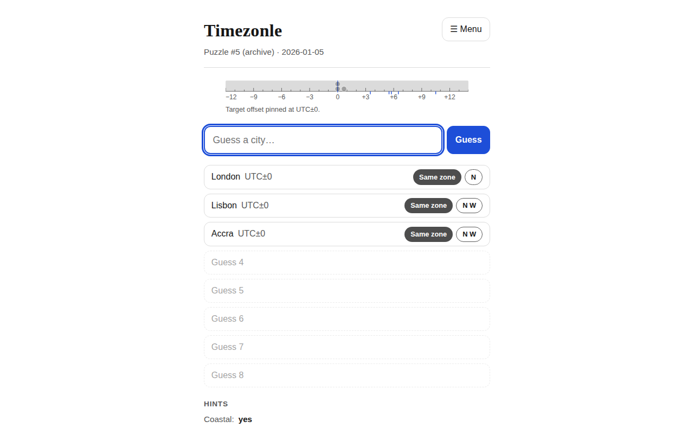

# Timezonle

**Guess the hidden city from its timezone — a new puzzle every day.**

🎮 Play it live: **https://timezonle.vercel.app/**



## What is it?

Timezonle is a daily geography puzzle game. Each day a mystery city is picked
for you. You have **8 guesses** to find it. After every guess the game tells
you how the mystery city's UTC offset compares to your guess — but never the
distance, and never the country.

## Aim

Find the target city in as few guesses as possible, then come back tomorrow to
keep your streak alive. Share your result with friends using the emoji grid.

## How to play

1. Type a city name and pick it from the suggestions.
2. Read the feedback chip on your guess:
   - **↑ Higher** — the target's UTC offset is greater (it's further east).
   - **↓ Lower** — the target's UTC offset is smaller (it's further west).
   - **Same zone** — same offset! The 1st such miss reveals whether the
     target is **north or south** of your guess, the 2nd adds **east/west**,
     and from the 3rd miss you unlock one extra hint at a time: coastal or
     inland, capital or not, daylight saving or not, population bracket,
     first letter.
   - **Correct** — you found it! 🎉
3. Watch the **offset ruler** above your guesses: every guess plants a marker
   at its offset, and everything ruled out greys away so the remaining
   interval stays highlighted.
4. A new puzzle drops at **UTC midnight**. Miss a day and your streak resets.
   Revisit old puzzles via **☰ Menu → Archive**, and use the in-game menu for
   stats, export/import, and how-to-play.

Example share result:

```
Timezonle #5 4/8
🧭🧭🧭🟩
```

## How it works (technical overview)

- **Static web app** — Vite + TypeScript, no backend, no UI framework, no map
  library. All game data ships as JSON in `public/data/`; all logic runs in
  the browser.
- **Offsets** are computed live with `Intl.DateTimeFormat` for the city's
  IANA timezone at 12:00 UTC on the puzzle date (minute precision, so +5:30
  vs +5:45 counts). "Observes DST" = offset differs between Jan 1 and Jul 1.
- **The answer is never in plain text.** The schedule stores SHA-256 hashes
  of `salt + cityId`; the client finds its target by comparing hashes.
- **Feedback is a pure function** of (guess, target, puzzle date) —
  see `src/logic/feedback.ts`.
- **Progress lives in your browser** — a versioned `localStorage` save with
  streak validation, cross-tab sync, and JSON export/import. No account,
  no tracking.

## Develop

```bash
npm install
npm run dev        # local dev server
npm run build      # typecheck + production build into dist/
npm run preview    # serve the production build
npm test           # vitest suite (43 tests)
npm run screenshots  # acceptance screenshots into screenshots/
```

## Data pipeline

The pipeline lives in `scripts/`; its outputs are committed to `public/data/`
(`cities.json`, `targets.json`, `schedule.json`).

```bash
npm run data:fetch     # download GeoNames dumps (or see scripts/raw/README.md if offline)
npm run data:all       # cities -> targets -> schedule -> validate
npm run data:validate  # CI gate: exits non-zero on any inconsistency
```

- **Cities**: GeoNames dump (or the committed `scripts/fallback-cities.json`
  sample) → compact arrays-of-arrays with a header row; fails if over
  700 KB gzipped.
- **Targets**: population > 1M plus all national capitals, minus
  `scripts/target-exclusions.txt`. Coastal flags come from the Natural Earth
  10m coastline (`--with-coastline`) or `scripts/coastal-overrides.json`.
  Prints a per-offset histogram and warns if one offset holds > 15%.
- **Schedule**: seeded shuffle (seed `20260101`) stored as salted hashes.
  Append-only — regeneration keeps existing entries and appends new ones.
- **Validate**: targets exist, every tz resolves in `Intl`, no duplicate ids
  or schedule entries.

**Attribution:** city data © GeoNames, CC BY 4.0
(https://creativecommons.org/licenses/by/4.0/) — also credited in the app footer.

## Deploy

Static hosting only: build and serve `dist/`. Live at
https://timezonle.vercel.app/ (Vercel, Vite preset, output `dist/`).

```bash
npm run build
```

## Layout

- `src/data/` — loaders, autocomplete index
- `src/logic/` — offset, feedback, schedule, stats, clock, constants
- `src/storage/` — versioned localStorage save + export/import
- `src/ui/` — app shell, autocomplete, offset ruler, world graticule
- `scripts/` — data pipeline + screenshots
